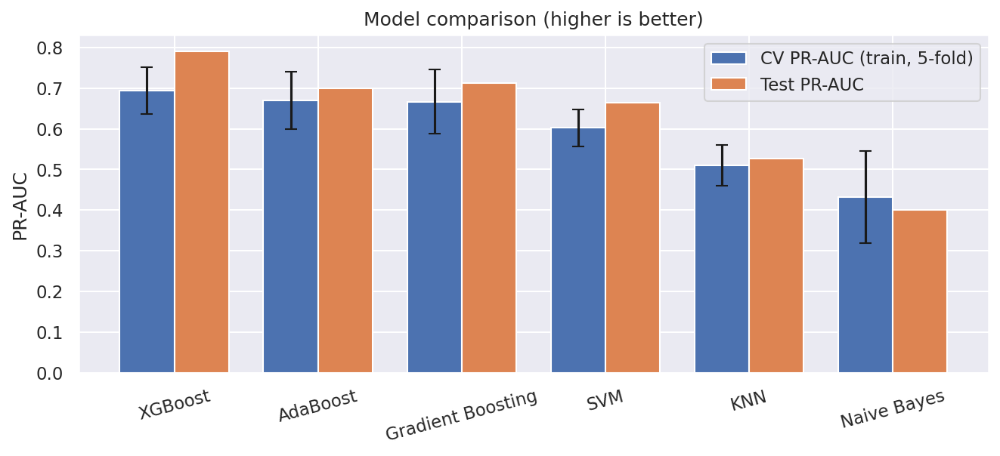
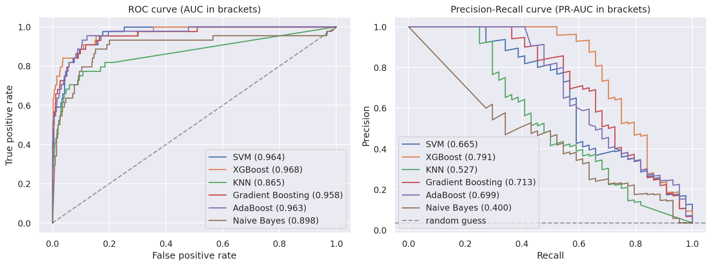

# Company Bankruptcy Prediction

Predicting whether a company will go bankrupt from its annual financial ratios, using six machine-learning classifiers on a heavily imbalanced dataset (about 3% bankrupt).

University project: **IT2011 Artificial Intelligence and Machine Learning** (SLIIT, Faculty of Computing, 2026 Year 2 Semester 1), Group ID `2026-Y2-S1-MET-16`.

## Highlights

- **Dataset:** Taiwanese Bankruptcy Prediction (UCI), 6,819 companies x 95 financial ratios, 1999-2009.
- **Task:** supervised binary classification (`Bankrupt?` = 1 / 0) with severe class imbalance.
- **Preprocessing:** constant-column removal, missing/duplicate check, IQR outlier removal (healthy companies only, so all 220 bankrupt rows are kept), MinMax scaling, correlation-based feature selection, one engineered feature (`Profitability Ratio`), stratified 80/20 split.
- **Models:** SVM, XGBoost, KNN, Gradient Boosting, AdaBoost, Gaussian Naive Bayes, each tuned with `GridSearchCV` (3-fold, PR-AUC) and compared with SMOTE, under-sampling and class weights.
- **Evaluation:** precision, recall, F1, ROC-AUC, PR-AUC, confusion matrices, stratified 5-fold CV, train-vs-test overfitting check, threshold study.
- **Best model:** **XGBoost** (test PR-AUC 0.791, ROC-AUC 0.968, recall 0.841).

## Results (test set: 1,240 companies, 44 bankrupt)

| Model | Accuracy | Precision | Recall | F1 | ROC-AUC | PR-AUC |
|---|---|---|---|---|---|---|
| SVM | .892 | .232 | .886 | .368 | .964 | .665 |
| **XGBoost** | .926 | .303 | .841 | .446 | **.968** | **.791** |
| KNN | .970 | 1.000 | .159 | .275 | .865 | .527 |
| Gradient Boosting | .931 | .319 | .818 | **.459** | .958 | .713 |
| AdaBoost | .897 | .244 | **.909** | .385 | .963 | .699 |
| Naive Bayes | .963 | .469 | .341 | .395 | .898 | .400 |

KNN has the highest accuracy but misses 37 of the 44 bankrupt companies, a clear example of why accuracy is misleading on imbalanced data. Because PR-AUC is more informative than ROC-AUC here, it was used as the main tuning and selection metric.




## Project Structure

```
company-bankruptcy-prediction/
├── README.md
├── requirements.txt
├── group_pipeline.ipynb          # Master notebook: full pipeline, raw data -> final model -> predictions
├── notebooks/
│   ├── preprocessing/            # One notebook per preprocessing technique
│   └── models/                   # One notebook per model (SVM, XGBoost, KNN, GB, AdaBoost, NB)
├── data/
│   ├── raw/                      # Put data.csv here (see data/raw/README.md)
│   └── external/                 # Sample new companies (raw units) for the demo prediction
├── results/
│   ├── eda_visualizations/       # Plots (PNG)
│   ├── logs/                     # Run log
│   └── outputs/                  # Processed data, splits, result tables, saved model
└── report/
    ├── Final_Group_Report.pdf    # Full written report
    └── Proposal_Presentation.pptx
```

## Pipeline Workflow

1. Raw data (6,819 x 96)
2. Remove constant column (`Net Income Flag`)
3. Check missing values and duplicates (none found)
4. IQR outlier removal on healthy companies only (6,819 -> 6,198 rows)
5. MinMax scaling
6. Correlation-based feature selection (|r| < 0.02 dropped, 94 -> 62 features)
7. Feature engineering: `Profitability Ratio = ROA(C) / (ROA(A) + 0.0001)` (63 features)
8. Stratified 80/20 split (`random_state=42`)
9. Tune six models with 3-fold CV, then compare with 5-fold CV
10. Test once, compare, choose the model with the highest CV PR-AUC

## How to Run

1. Clone the repo and install dependencies:
   ```bash
   pip install -r requirements.txt
   ```
2. Download the dataset (link in `data/raw/README.md`) and save it as `data/raw/data.csv`.
3. Open `group_pipeline.ipynb` in Jupyter or Google Colab and run all cells (about 2 minutes). Outputs are written to `results/`.

Settings in the notebook: `RUN_GRID_SEARCH = True` repeats the full grid search (10+ minutes); `DECISION_THRESHOLD` changes the "bankrupt" cut-off (default 0.5).

The individual notebooks in `notebooks/models/` read `train_set.csv` / `test_set.csv` from their own folder; copy those files from `results/outputs/` (created by the pipeline) next to the notebook, or upload them when running in Colab.

## Known Limitations

- Only 44 bankrupt companies in the test set, so metrics can vary a lot between splits (one company is about 2.3 points of recall).
- The MinMax scaler and correlation filter were fitted on the whole dataset before the split (small data leakage). A scikit-learn `Pipeline` fitted on the training set only would fix this.
- Small hyperparameter grids; the decision threshold was fixed at 0.5 for the reported test results.
- One market and one period (Taiwan, 1999-2009), so results may not generalise elsewhere.
- Intended as a decision-support tool, not for automated lending or investment decisions.

Possible improvements: nested cross-validation, wider search spaces, cost-based threshold selection, Random Forest / Logistic Regression baselines, SHAP interpretability.

## Team

| Name | Preprocessing contribution | Model |
|---|---|---|
| Sandeepana A. G. P. | Feature engineering | XGBoost |
| Raveenath K. A. Y. | Feature scaling | KNN |
| Rathnaweera R. P. S. D. | Constant columns, rename columns | Gradient Boosting |
| Adhikari A. A. P. P. | Missing values and duplicates | Naive Bayes |
| Parindya K. P. | Outlier removal (IQR) | SVM |
| De Silva S. L. O. D. | Correlation heatmap, feature selection | AdaBoost |

## References

- Liang, D., Lu, C.-C., Tsai, C.-F., & Shih, G.-A. (2016). Financial ratios and corporate governance indicators in bankruptcy prediction. *European Journal of Operational Research, 252*(2), 561-572.
- UCI Machine Learning Repository: Taiwanese Bankruptcy Prediction dataset.
- Chen & Guestrin (2016), XGBoost; Chawla et al. (2002), SMOTE; Pedregosa et al. (2011), scikit-learn.

Full reference list is in `report/Final_Group_Report.pdf`.
